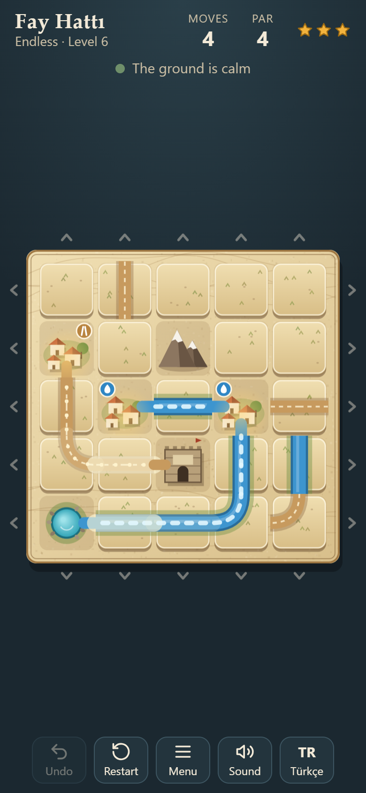

# Fay Hattı — Fault Line

A daily sliding-tile puzzle on a map of Anatolia, made for **GitHub Game Off 2026** (theme: **SHIFT**).
Shift rows and columns to bring rivers and caravan roads to the villages. After every move a small earthquake shifts one row on its own.

**Play:** https://furkiozknn.github.io/fay-hatti/

- **Daily puzzle:** everyone gets the same map each day (seeded by the date).
- **Endless mode:** numbered levels that grow from 2 villages and short solutions to 3 villages, mountains and longer solutions.
- One HTML file, no downloads, no external requests. Phone first (portrait & landscape), works on desktop. English and Turkish.

## How to play

1. Drag a row sideways or a column up or down, or tap the arrows around the board. Tiles that leave one edge come back on the other.
2. Villages, mountains, the spring and the caravanserai never move: the other tiles slide past them.
3. Each village shows what it needs: a water drop (river from the spring) and/or a road sign (road from the caravanserai). Connect every need to solve the map.
4. After each of your moves a small quake shifts one row by one tile. The red band and the line above the board show which row is next and which way it will go. If your move solves the map, the ground stays calm.
5. Solve within par (the fewest possible moves) for 3 stars, par + 2 for 2 stars. Share your result without spoilers.

**Controls:** drag or tap the arrows (with swipe thresholds and accidental-swipe guard); keyboard WASD moves the cursor, arrow keys shift its row or column, Z or Backspace undo, R restart, M mute, Esc menu. One-hand reach layout places Undo/Restart right under your right or left thumb.

## URL flags

| Flag | Effect |
|---|---|
| `?seed=YYYYMMDD` | Play the daily map of that date (any short word also works as a seed) |
| `?level=N` | Play endless level N |
| `?reach=right` / `?reach=left` | One-hand reach layout for right or left thumb |
| `?demo=1` | The bot solves the map visibly, about one move every 0.8 s (strategy A) |
| `?demo=a` / `?demo=b` | Bot strategy A (optimal planner) or B (greedy beam search, often slower) for "bot race" videos |
| `?auto` | Fast bot (strategy A; add `&demo=b` for B) |
| `?debug` | fps, seed, par, generation time overlay |
| `?lang=en` / `?lang=tr` | Force the language (default: Turkish for Turkish browsers, English otherwise) |
| `?nosave` | Do not write to localStorage |

`window.fayHatti` exposes `seed`, `moves`, `solved`, `state` (`loading`, `play`, `won`), `par`, `stars`, `mode`, `level`, `nextQuake`, `bot`, `plan`, `board`, `fps`, `genMs`, `reach` and the actions `move(code)`, `undo()`, `restart()`, `start(mode, arg)`, `setReach(v)`. A move code is `line * 2 + dir`: lines 0-4 are rows, 5-9 columns; dir 0 is right/down, 1 is left/up.

Saves use localStorage keys starting with `fayhatti.` (language, mute, daily results, endless level, help seen).

## How it works

- **Generator:** places the spring, caravanserai, villages and mountains, routes a river and a road network to every need (randomised shortest paths), fills the rest with decoy tiles, then scrambles the solved board by playing K moves backwards, undoing each quake as well. So a solution of at most K moves always exists.
- **Solver (bot A):** iterative-deepening search with a transposition table over (board, quake phase). It finds the fewest-moves solution, which becomes the par.
- **Bot B:** a beam search guided by a greedy score (connected villages, network size, distance to the next village). It plays "by feel" and often needs more moves.
- `node tools/sim.mjs [fromDate] [days] [endlessLevels]` runs the same engine in Node and replays both bots' solutions under the real rules.

## Devlog

See [CHANGELOG.md](CHANGELOG.md): one line per day with measured numbers.

Made with AI: code and visuals by Claude (Anthropic) models under our direction.

## License

MIT. See [LICENSE](LICENSE).
